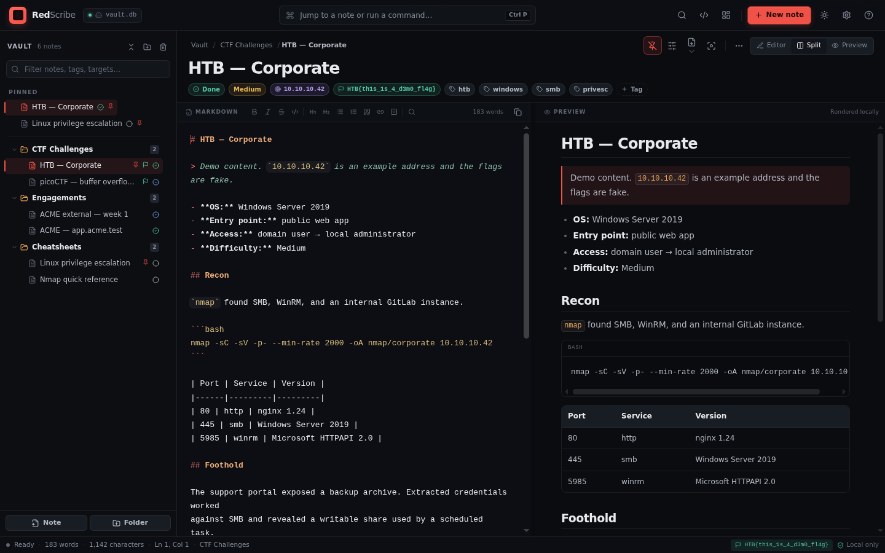

<div align="center">

# RedScribe

**A local-first security research notebook for CTFs, pentests, and offensive-security work.**

One SQLite vault. No accounts. No telemetry. No network calls.

</div>



RedScribe is a desktop notes app with a CherryTree-style tree, a focused Markdown
editor, live preview, full-text search, CTF flag tracking, target metadata, and a
searchable library of offensive-security command snippets. The default frontend is
**Aurora**, a bundled React interface served locally by Python and opened in a
native webview or browser.

## Table of contents

- [Why RedScribe](#why-redscribe)
- [Highlights](#highlights)
- [Install](#install)
- [Quick start](#quick-start)
- [Shortcuts](#shortcuts)
- [The v4 program](#the-v4-program)
- [Architecture](#architecture)
- [Development](#development)
- [Documentation](#documentation)
- [Authorized use only](#authorized-use-only)
- [License](#license)

## Why RedScribe

Most note-taking tools either trust your data to a cloud service or force you to
assemble a workflow out of unrelated apps. RedScribe is built for the way security
research actually happens:

- **Everything stays local.** Your entire vault is a single SQLite file you can
  back up, sync, or move. The app ships with no external assets and makes no
  outbound requests.
- **Notes understand the domain.** A note can carry a target, a status, a
  difficulty, tags, and a captured flag. Templates cover CTF challenges, host
  recon, web assessments, findings, and engagement logs.
- **Reference material is built in.** Over 70 commands for recon, web, Active
  Directory, credentials, shells, privesc, pivoting, and CTF tooling are searchable
  straight from the quick switch.
- **It grows with a program.** The v2, v3, and v4 delivery trains add first-class
  engagements, findings, evidence, automation, reporting, graph analysis, a
  security vault, and accessibility — without breaking the offline core.

## Highlights

### Capture & organize

- Hierarchical folders and notes, drag-and-drop organizing, and auto-save.
- Instant fuzzy jump to notes or folders with `Ctrl+P`, full-text search with
  `Ctrl+Shift+F`, and a quick-capture bar with `Ctrl+Shift+Q`.
- A universal **capture inbox** that parses raw text, links, snippets, and flags,
  renders templates, and triages items with a state machine.
- First-class tags with autocomplete, one-click inspector chips, and a tag explorer
  with live usage counts.
- Undo trash from the tree, workspace menu, or `Delete` key, with restore from the
  toast or the trash view.

### Write & review

- Markdown editor with syntax highlighting, split preview with code highlighting,
  optional synchronized scrolling, and find/replace.
- A **pro block editor** with slash commands, a markdown round-trip codec, a diff
  gutter, autosave snapshots, and a focus mode.
- Export a note to Markdown or HTML, or export the whole vault as a browsable HTML
  report.
- A **report designer** with page layouts, reusable themes, deterministic
  pagination, cover/TOC/appendix sections, and client-ready exports.

### Analyze & prove

- **Flag intelligence**: a registry of known event formats with validation and
  one-tap prefix presets. The dashboard spots duplicate flags and notes that are
  done but missing a flag.
- **CVSS v4 findings**: base, threat, and environmental scoring, severity bands, a
  lifecycle state machine, remediation tracking, and retest history.
- An **evidence lab** with hex dumps, strings extraction, hash verification, a
  chain-of-custody graph, and bundle diffs.
- A **graph workbench** that maps folder hierarchy and `[[wikilinks]]`, with degree
  analysis, connected components, shortest paths, deterministic layouts, and
  filters.
- A **structured query language** with fields, operators, boolean expressions,
  facets, saved searches, and result clustering.

### Automate & protect

- **Playbook automation** as data only: DAG validation, topological execution,
  dry-run traces, schedules, and run history. RedScribe never executes user-defined
  commands.
- A **security vault** with sealed envelopes, PBKDF2-derived keys, key rotation,
  single-use recovery codes, redaction rules, and privacy modes.
- A **local API and CLI** for power users, with an additive `/api/v4/*` surface and
  a stable JSON envelope.
- Accessibility and i18n: audit rules, RTL layouts, locale catalogs, motion
  policies, focus rings, an onboarding tour, and three density modes.

### Interface

A responsive React workspace with a real-data dashboard, command palette,
inspector, snippet library, and warm light or graphite dark themes. Spring-based
transitions, a sliding selection indicator, animated counters, a reading progress
bar, view-transition theme changes, and a Motion lab with System, Full, Subtle,
and Off modes.

## Install

```bash
python -m pip install ".[web]"   # native window (pywebview)
redscribe
```

Without the `web` extra, RedScribe falls back to the default browser. From a
source checkout:

```bash
python -m venv .venv
source .venv/bin/activate           # Windows: .venv\Scripts\activate
python -m pip install -e ".[dev]"
python -m redscribe --demo
```

Linux users may need WebKitGTK for the native window:
`sudo apt-get install python3-webkit2gtk`.

## Quick start

1. Launch RedScribe. The first-run dashboard can load the demo vault.
2. Create a **CTF challenge** or **Host recon** note and fill in the target.
3. Write notes in Markdown. Press `Ctrl+E` to cycle editor, split, and preview.
4. Press `Ctrl+P` to jump anywhere or `Ctrl+Shift+S` for snippets.
5. Capture raw text with `Ctrl+Shift+Q`, then triage it from the inbox.
6. Export a single note or the whole vault from the **File** menu.

The default vault lives in your OS data directory (`%APPDATA%\RedScribe` on
Windows, `~/Library/Application Support/RedScribe` on macOS, and
`~/.local/share/redscribe` on Linux). Override it with `--vault PATH`.

## Shortcuts

| Shortcut | Action |
| --- | --- |
| `Ctrl+N` | New note (last template) |
| `Ctrl+Shift+N` | New folder |
| `Ctrl+P` | Quick switch / command palette |
| `Ctrl+Shift+F` | Full-text search |
| `Ctrl+Shift+S` | Snippets |
| `Ctrl+Shift+D` | Dashboard |
| `Ctrl+Shift+G` | Vault graph / graph workbench |
| `Ctrl+Shift+I` | Capture inbox |
| `Ctrl+Shift+Q` | Quick capture / query |
| `Ctrl+Shift+A` | Automation |
| `Ctrl+Shift+R` | Report designer |
| `Ctrl+Shift+V` | Security vault |
| `Ctrl+P` | Pin or unpin the current note |
| `Ctrl+E` | Cycle editor / split / preview |
| `Ctrl+S` | Save now |
| `Ctrl+,` | Settings |
| `Ctrl+F` / `Ctrl+H` | Find / replace |
| `F2` | Note properties |
| `Delete` | Move the selected tree item to trash |
| `F1` | All shortcuts |

When the editor has focus: `Ctrl+B` bold, `Ctrl+I` italic, `Ctrl+K` inline code,
`Ctrl+Shift+X` strikethrough, `Tab` / `Shift+Tab` indent, and `Ctrl+Z` / `Ctrl+Y`
undo and redo. The full list is in [docs/SHORTCUTS.md](docs/SHORTCUTS.md).

## The v4 program

v4 extends RedScribe with ten independently delivered feature slices on top of a
shared platform kernel. Each branch adds substantial, tested code and a real UI.

| Branch | Feature |
| --- | --- |
| `dev/v4-00-platform-kernel` | Contracts, event bus, schema v6, API v4 envelope, design tokens |
| `dev/v4-01-capture-inbox` | Capture parsing, templates, triage state machine, inbox UI |
| `dev/v4-02-finding-cvss-v4` | CVSS v4 scoring, finding lifecycle, remediation, finding studio |
| `dev/v4-03-evidence-lab` | Hex/strings inspection, hashing, custody graph, lab UI |
| `dev/v4-04-block-editor-pro` | Block codec, diff, autosave snapshots, pro editor |
| `dev/v4-05-query-language` | Query parser, facets, saved searches, clustering |
| `dev/v4-06-playbook-automation` | DAG executor, dry-run trace, schedules, automation UI |
| `dev/v4-07-report-designer` | Page layouts, themes, pagination, page designer |
| `dev/v4-08-graph-workbench` | Link analysis, layouts, filters, graph canvas |
| `dev/v4-09-security-vault` | Sealed envelopes, key rotation, recovery, privacy modes |
| `dev/v4-10-a11y-i18n-polish` | Audit rules, i18n catalogs, motion policy, accessible UI |

See [docs/V4_MASTER_PLAN.md](docs/V4_MASTER_PLAN.md) for scope, LOC targets, merge
order, and acceptance criteria, and [docs/V4_ARCHITECTURE.md](docs/V4_ARCHITECTURE.md)
for the shared seams.

## Architecture

RedScribe is a Python standard-library core, one SQLite vault, a loopback-only JSON
API, and a bundled React/Zustand frontend. A v4 request flows through a stable
envelope, a capability gate, a typed service, a storage adapter, and an event bus;
events are redacted before they reach the durable outbox.

```
React / Zustand frontend  →  /api/v4/* envelope  →  v4 service  →  SQLite vault
                                     ↓
                          capability gate + event bus
```

The core has zero required runtime dependencies; optional extras only add a native
webview. Architecture, API, and design-system references are linked below.

## Development

```bash
python -m ruff check .
python -m ruff format --check .
PYTHONPATH=src python -m mypy src
PYTHONPATH=src python -m pytest -q -p no:asyncio
```

Frontend work lives in `frontend/` and uses Node 20+:

```bash
cd frontend
npm install
npm run dev           # watch and rebuild the Python static bundle
npm test              # typecheck + all test suites
npm run format:check
npm run typecheck
npm run build         # production bundle
```

The LOC gate measures net lines against a fixed baseline and enforces per-branch
and program totals:

```bash
python3 scripts/loc_gate.py --baseline V4_BASELINE --min-net 2500 --min-test-loc 400
```

## Documentation

| Topic | Reference |
| --- | --- |
| Architecture | [docs/ARCHITECTURE.md](docs/ARCHITECTURE.md), [docs/V4_ARCHITECTURE.md](docs/V4_ARCHITECTURE.md) |
| API | [docs/API_V2.md](docs/API_V2.md), [docs/API_V3.md](docs/API_V3.md), [docs/API_V4.md](docs/API_V4.md) |
| Design system | [docs/DESIGN_SYSTEM.md](docs/DESIGN_SYSTEM.md), [docs/DESIGN_SYSTEM_V3.md](docs/DESIGN_SYSTEM_V3.md), [docs/DESIGN_SYSTEM_V4.md](docs/DESIGN_SYSTEM_V4.md) |
| Motion & a11y | [docs/MOTION.md](docs/MOTION.md), [docs/ACCESSIBILITY.md](docs/ACCESSIBILITY.md) |
| Programs | [docs/V2_MASTER_PLAN.md](docs/V2_MASTER_PLAN.md), [docs/V3_MASTER_PLAN.md](docs/V3_MASTER_PLAN.md), [docs/V4_MASTER_PLAN.md](docs/V4_MASTER_PLAN.md) |
| Branching & gates | [docs/BRANCH_PLAYBOOK.md](docs/BRANCH_PLAYBOOK.md), [docs/V4_BRANCH_PLAYBOOK.md](docs/V4_BRANCH_PLAYBOOK.md), [docs/QUALITY_GATES.md](docs/QUALITY_GATES.md), [docs/V4_QUALITY_GATES.md](docs/V4_QUALITY_GATES.md) |
| Feature docs | `docs/v2/`, `docs/v3/`, `docs/v4/` |
| Shortcuts | [docs/SHORTCUTS.md](docs/SHORTCUTS.md) |
| Contributing | [CONTRIBUTING.md](CONTRIBUTING.md), [SECURITY.md](SECURITY.md) |

## Authorized use only

RedScribe is for CTF competitions, labs, and engagements where you have explicit
written permission. The snippets are reference material. You are responsible for
how you use them.

## License

MIT — see [LICENSE](LICENSE).
