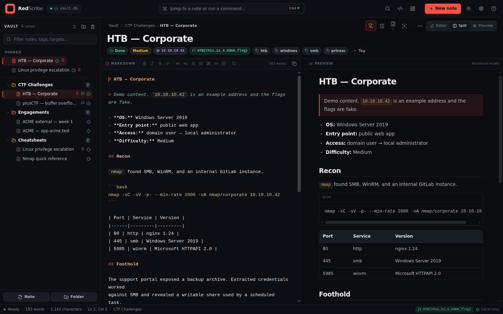

# RedScribe

**A lightweight, local-first notebook for CTFs, pentests, and security research.**

RedScribe is a desktop notes app with a CherryTree-style tree, a focused Markdown
editor, live preview, full-text search, CTF flag tracking, target metadata, and a
searchable library of offensive-security command snippets. One SQLite vault. No
accounts. No telemetry. No runtime dependencies beyond Python and Tkinter.



## Highlights

- **Fast capture.** Hierarchical folders and notes, drag-and-drop organizing,
  instant fuzzy jump to notes or folders with `Ctrl+P`, full-text search with
  `Ctrl+Shift+F`, and auto-save.
- **Built for security work.** Templates for CTF challenges, host recon, web
  assessments, findings, and engagement logs. Notes carry a target, status,
  difficulty, tags, and a captured flag.
- **Useful snippets.** More than 70 built-in commands for recon, web, Active
  Directory, credentials, shells, privesc, pivoting, and CTF tooling. Copy with
  placeholders filled from the current note.
- **Readable output.** Markdown editor with syntax highlighting and a split
  preview with code highlighting and optional synchronized scrolling. Export a
  note to Markdown or HTML, or export the whole vault as a browsable HTML report.
- **Small and portable.** Pure standard library. The entire vault is one file
  that you can back up, sync, or move.

## Install

```bash
python -m pip install .
redscribe
```

Or run it from the source tree:

```bash
python -m venv .venv
.venv\Scripts\activate          # Windows
python -m pip install -e ".[dev]"
python -m redscribe --demo
```

Linux users need Tkinter: `sudo apt-get install python3-tk`.

## Quick start

1. Launch RedScribe. The first-run dashboard can load the demo vault.
2. Create a **CTF challenge** or **Host recon** note and fill in the target.
3. Write notes in Markdown. Press `Ctrl+E` to cycle editor, split, and preview.
4. Press `Ctrl+P` to jump anywhere, or `Ctrl+Shift+S` for snippets.
5. Export a single note or the whole vault from the **File** menu.

The default vault lives in your OS data directory (`%APPDATA%\RedScribe` on
Windows, `~/Library/Application Support/RedScribe` on macOS, and
`~/.local/share/redscribe` on Linux). Override it with `--vault PATH`.

## Shortcuts

| Shortcut | Action |
| --- | --- |
| `Ctrl+N` | New note (last template) |
| `Ctrl+Shift+N` | New folder |
| `Ctrl+P` | Quick switch |
| `Ctrl+Shift+F` | Full-text search |
| `Ctrl+Shift+S` | Snippets |
| `Ctrl+Shift+D` | Dashboard |
| `Ctrl+Shift+P` | Pin or unpin the current note |
| `Ctrl+E` | Cycle editor / split / preview |
| `Ctrl+S` | Save now |
| `Ctrl+,` | Settings |
| `Ctrl+F` / `Ctrl+H` | Find / replace |
| `F2` | Note properties |
| `Delete` | Move the selected tree item to trash |
| `Ctrl+Up` / `Ctrl+Down` | Reorder the selected tree item |
| `F1` | All shortcuts |

When the editor has focus: `Ctrl+B` bold, `Ctrl+I` italic, `Ctrl+K`
inline code, `Ctrl+Shift+X` strikethrough, `Tab` / `Shift+Tab` indent, and
`Ctrl+Z` / `Ctrl+Y` undo and redo. The full list is in
[docs/SHORTCUTS.md](docs/SHORTCUTS.md).

## Development

```bash
python -m ruff check .
python -m ruff format --check .
python -m mypy src
python -m pytest -m "not gui"
```

The GUI smoke test runs with `python -m pytest -m gui` on a machine with a
display. Architecture notes live in
[docs/ARCHITECTURE.md](docs/ARCHITECTURE.md).

Command-line options:

```bash
redscribe --vault PATH     # use a specific SQLite vault
redscribe --demo           # seed example notes into an empty vault
redscribe --theme light    # override the stored theme
redscribe --font-size 13   # override the stored UI font size
redscribe --version
```

## Authorized use only

RedScribe is for CTF competitions, labs, and engagements where you have explicit
written permission. The snippets are reference material. You are responsible
for how you use them.

MIT licensed.
